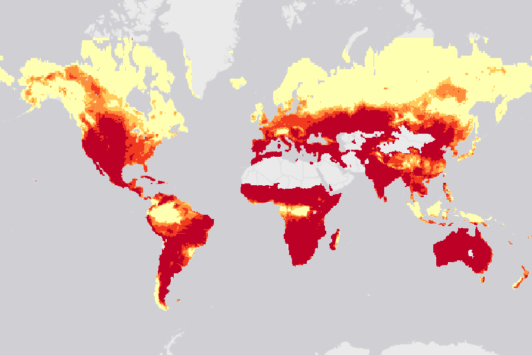

# Wildfire Hazard: FWI, 2-Year Return Period

The yearly maximum 12 noon Fire Weather Index (FWI) expected once in 2 years,
on a global 0.5° grid. Higher values mean weather that favors severe fire.

## What the data shows

[CSIRO](https://www.csiro.au/) fit a GEV distribution to the yearly maxima of
daily FWI in NASA's
[Global Fire Weather Database](https://data.giss.nasa.gov/impacts/gfwed/), from
1981 to 2016. This grid gives the FWI value that the fit expects once in 2
years. [ThinkHazard!](https://thinkhazard.org/) combines this grid with the
[10-year](../fwi-rp10/README.md) and
[30-year](../fwi-rp30/README.md) grids into four wildfire hazard
classes. The [technical basis](https://datacatalogfiles.worldbank.org/ddh-published/0066912/DR0095597/THhazardclass_Wildfire_CSIRO.pdf) gives the method and the thresholds.

GFWED masks oceans, large lakes, and deserts. Those cells hold 0. The
[agent guide](AGENTS.md) and the [catalog guide](../AGENTS.md) list this quirk
and the others, with recipes that run.

## Files

| Asset | What it is |
|---|---|
| `data` | `csiro_wf_max_fwi_rp2.tif`, a Float32 COG with embedded statistics |
| `source` | The World Bank original GeoTIFF, resource DR0095654 |
| `technical_basis` | The CSIRO technical basis PDF |
| `thumbnail` | The preview above |

## License

[CC BY 4.0](https://creativecommons.org/licenses/by/4.0/), as the
[World Bank Data Catalog](https://datacatalog.worldbank.org/search/dataset/0066912/global-wildfire-hazard) lists it. Attribute the World Bank and CSIRO.

## Provenance

- **Producer:** CSIRO, for the World Bank's ThinkHazard! tool, in 2017.
- **Publisher:** the World Bank, [dataset 0066912](https://datacatalog.worldbank.org/search/dataset/0066912/global-wildfire-hazard). The World Bank
  lists the dataset as "No further updates planned".
- **Mirror:** [portolan-mirrors/wb-fwi](https://source.coop/portolan-mirrors/wb-fwi)
  on Source Cooperative, built by [nlebovits/wb-fwi](https://github.com/nlebovits/wb-fwi).
  The build converts the GeoTIFF to a COG with DEFLATE compression and
  embedded statistics. It changes no pixel value.
